# PS 1 — Lane Marking and Background Isolation

A classical computer-vision pipeline that takes the provided road photo and produces a **binary bitmap**: the vehicle's own lane is **black**, everything else is **white**. It uses only OpenCV, NumPy and Matplotlib, with no pretrained models.

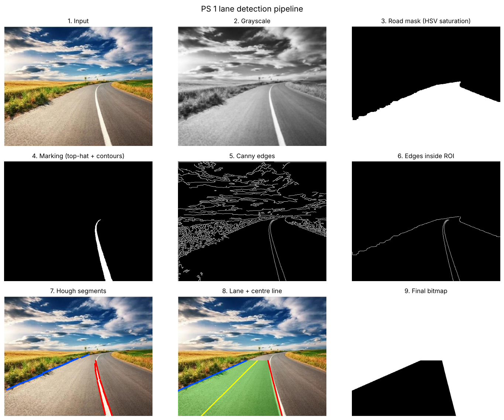

## Files

| File | What it does |
| --- | --- |
| `lane_detection.py` | The main pipeline, one function per stage. Saves every intermediate image and the final bitmap. |
| `bonus_experiments.py` | The three bonus tasks: lighting/clutter test, missing boundary, drivable area and cost map. |
| `input/road.jpg` | The test photo, extracted from page 5 of the problem-statement PDF (492 × 396 px). |
| `output/` | All results (listed below). Every file is regenerated each time the scripts run. |

## How to run (VS Code on Windows)

1. Install Python 3.10+ from python.org, ticking **"Add Python to PATH"**.
2. In VS Code, install the **Python** extension (Microsoft), then open the repository folder.
3. Open a terminal (**Ctrl + `**) and install the libraries:
   ```
   pip install -r requirements.txt
   ```
4. Run the main pipeline, then the bonus tasks:
   ```
   python PS-1/lane_detection.py
   python PS-1/bonus_experiments.py
   ```
   Add `--show` to the first command to open a window with the overview. Use `--input path/to/other.jpg` to try another image.

The scripts find their own folder, so they work from any terminal location or from the ▶ Run button.

**Expected terminal output (main script):**
```
Image size            : 492 x 396
Left boundary segments: 10
Right boundary segments: 7
Lane pixels (black)   : 47857 (24.6 % of image)
Camera offset from lane centre (bottom row): 168 px (right of centre)
```

## Approach

**Which lane?** The camera sits left of the solid white line, so the vehicle's own lane runs from the **left road edge** to the **white line**. The left side has **no painted marking**: the road simply meets the grass. That boundary therefore has to be found from colour, not from paint.

| # | Stage | What it does and why | Key values |
| --- | --- | --- | --- |
| 1 | Preprocessing | Gaussian blur removes grain, then the image is converted to grayscale (for edges) and HSV (for colour). | 5 × 5 kernel |
| 2 | Thresholding: road | Asphalt is grey (saturation ≈ 60), while grass is strongly coloured (≈ 190). Pixels with low saturation are road. Morphology cleans the mask, and the largest region is kept. | S < 110 |
| 3 | Thresholding: marking | A **top-hat** filter keeps thin features brighter than their neighbourhood. White paint also has low saturation. | top-hat > 25, S < 80 |
| 4 | Contour filtering | Only long, thin contours are kept as markings. This removes bright patches of sunlit asphalt. | length ≥ 40 px, length/width ≥ 4 |
| 5 | Canny edges | Finds sharp brightness changes. | 50 / 150 |
| 6 | Region of interest | A polygon over the lower image removes sky and distant fields. Marking edges are kept only near the marking mask, and road-edge edges come from the outline of the road mask. | horizon at 46 % of height |
| 7 | Hough transform | `HoughLinesP` turns edge pixels into line segments. Left = road-edge segments with negative slope. Right = marking segments with steep positive slope. Image coordinates have y pointing down. | 20 votes, min length 20, max gap 15 |
| 8 | Boundary fitting | `np.polyfit` fits x = f(y) through each side's points. A degree-2 curve is used if the points span ≥ 150 rows, otherwise a straight line. Fitting x as a function of y suits near-vertical lane lines. | — |
| 9 | Lane region and centre | Walks from the bottom row up to the highest row where both sides have data, then fills the area between them. The centre line is the mid-point of the two boundaries. | — |
| 10 | Final bitmap | A white canvas (255) with the lane polygon filled black (0). It is saved as **PNG**, which is lossless, so the file contains only 0 and 255. | — |

**Why top-hat instead of a plain brightness threshold?** I first tried `V > 215`. It worked on the original image but found **nothing** in a darker version and **only sunlit asphalt** in a brighter version. The top-hat compares each pixel with its surroundings, so it found the line in all three versions.

## Results

| Stage | Image |
| --- | --- |
| Grayscale | 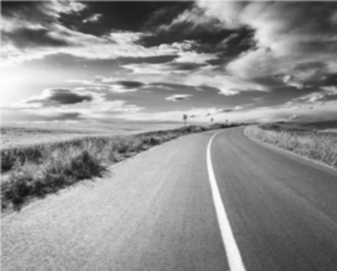 |
| Road mask (HSV saturation) | 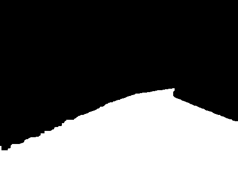 |
| Lane marking (top-hat + contours) | 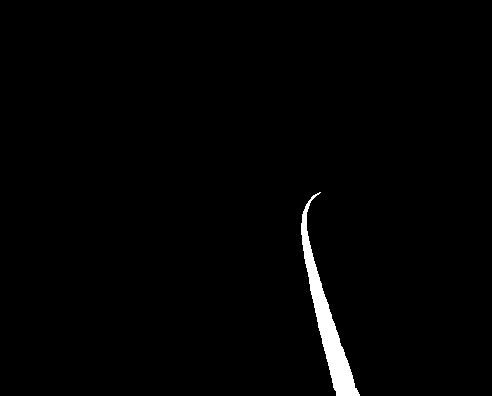 |
| Canny edges | 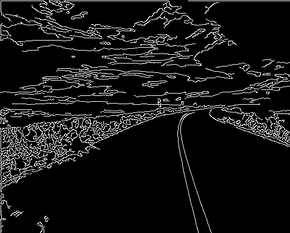 |
| ROI drawn on the edges | 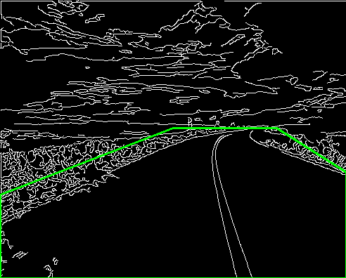 |
| Edges kept inside the ROI | 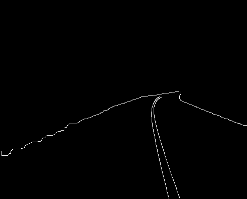 |
| Hough segments (blue = left, red = right) | 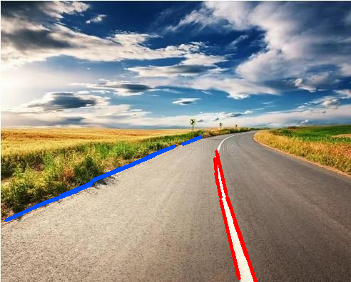 |
| Lane (green), boundaries and centre line (yellow) | 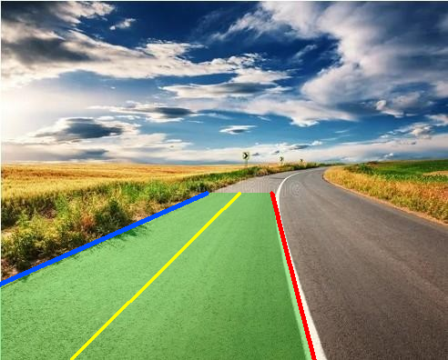 |
| **Final bitmap** | 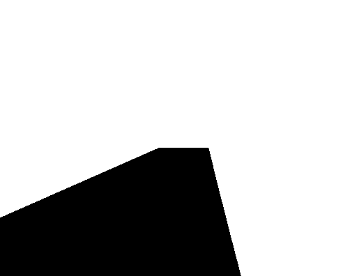 |

**Checks performed on `final_bitmap.png`:** single channel, `uint8`, unique values exactly `[0, 255]`. Sky, left grass, the right lane and the white line itself are white. Points inside the ego lane are black.

## Bonus extensions

### 1. Lighting and mild clutter

Six harder versions of the photo were made, and the pipeline ran on each with unchanged settings. The score is **IoU** (intersection over union) of the lane against the original result, where 1.0 means identical.

| Test | IoU |
| --- | --- |
| Darker (× 0.55) | 0.98 |
| Brighter (+ 45) | 0.93 |
| Low contrast | 0.89 |
| Sensor noise (σ = 12) | 0.99 |
| Two shadow bands across the road | 0.98 |
| Clutter (25 spots + 4 tar patches) | 0.99 |

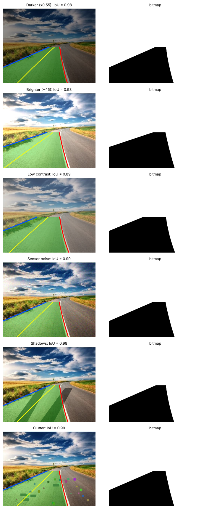

Saturation hardly changes with brightness, and the top-hat is relative, so lighting changes barely affect the result. Low contrast scores lowest because the road/grass border is detected over a shorter stretch, so the lane stops lower down.

### 2. Missing lane boundary

**Assumption:** the lane has a constant real-world width. Because of perspective, that width looks smaller farther away and shrinks to zero at the horizon. So the missing boundary = found boundary ± k·(y − y_horizon), where k makes the lane `LANE_WIDTH_AT_BOTTOM` × image width wide at the bottom row.

To test it, each boundary was thrown away in turn:

| Removed side | IoU vs. both detected |
| --- | --- |
| Left (road edge) | 0.97 |
| Right (white line) | 0.90 |

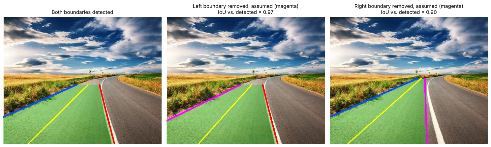

My first attempt mirrored the found boundary about the image centre, which assumes the camera is centred in its lane. It scored only **0.58 and 0.70**, because this camera is not centred in its lane. Note that `LANE_WIDTH_AT_BOTTOM = 1.0` was chosen by looking at this image. A real vehicle would get it from camera calibration (camera height plus a standard 3.5 m lane), so these scores are somewhat optimistic.

### 3. Drivable area and cost map

- `bonus3_drivable_area.png`: all asphalt (both lanes) in black, from the HSV road mask.
- `bonus3_cost_map.png` / `.npy`: 0 on the lane centre, rising to 0.5 at the lane edges, 0.7 on the other lane, and 1.0 off-road. A grid planner like A* from PS 2 could use these as cell costs.

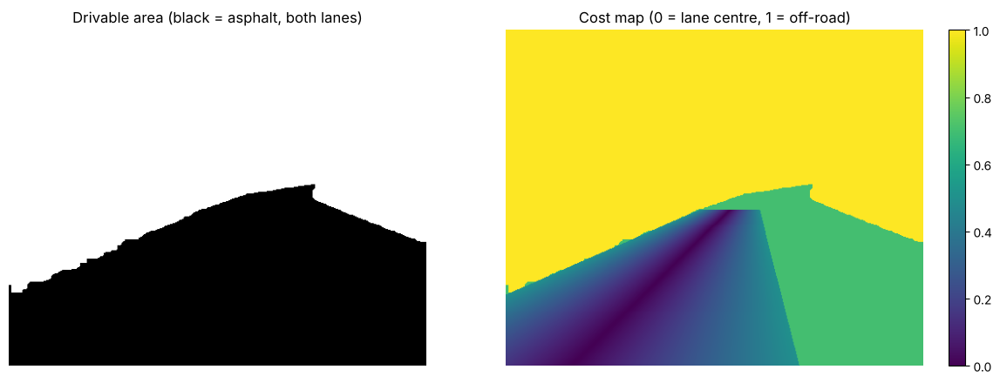

## What worked and what didn't

**Worked**
- Saturation separates asphalt from grass very cleanly in this scene. That is how the left boundary, which has no painted line, was found.
- Contour shape filtering removed the large bright patch of sunlit asphalt that a brightness threshold picked up.
- Slope rules separated the left and right segments reliably.

**Limitations and failure cases**
- **The lane stops at row 212, before the far bend.** The top of the white line curves to the right. Those segments have the wrong slope for the "right boundary" rule, so they are discarded, and the fit only covers the straighter lower part.
- **The right boundary is the middle of the white line**, because both of its edges are used. Whether the paint itself belongs to the lane is a choice; here it is split.
- **Tuned for one image.** The ROI, slope ranges and the HSV threshold suit a grey road between coloured fields. A grey road next to grey concrete, a road with yellow markings, or a night scene would need different settings.
- **Slope rules assume this layout:** road edge on the left, marking on the right. A road with painted lines on both sides would need the rule changed.
- **Single image, no memory.** A real system tracks the lane over many video frames and smooths the result. That would also give a better estimate for a missing boundary than a fixed width.

## Requirements checklist (from the problem statement)

| Requirement | Where | Evidence | Status |
| --- | --- | --- | --- |
| Pipeline takes the provided road image as input | `lane_detection.py`, `input/road.jpg` | runs on the PDF image | Done, tested |
| Region between lane boundaries is black, surroundings white | `detect_lane()` → `final_bitmap.png` | pixel checks above | Done, tested |
| Clear pipeline: preprocessing → filtering/thresholding → edges → ROI → lane detection → lane region/centre | one function per stage | `00_pipeline_overview.png` | Done |
| Understandable lane-boundary detection method | Canny + Hough + polyfit | Approach table | Done |
| No pretrained models | only OpenCV/NumPy/Matplotlib | imports | Done |
| At least one intermediate image | `output/01_…` to `09_…` | 9 intermediate images | Done |
| Bonus: lighting / mild clutter | `bonus_experiments.py` | `bonus1_robustness.png`, IoU table | Done, tested |
| Bonus: missing boundary with a reasonable assumption | `assume_missing_boundary()` | `bonus2_missing_boundary.png` | Done, tested |
| Bonus: drivable-area mask or cost representation | `bonus3_drivable_area()` | `bonus3_*.png`, `.npy` | Done |
| Comments on important logic | both scripts | — | Done |
| Note what worked and what failed | this README | section above | Done |
| Part A research PDF (`PS1_Research.pdf`) | — | — | **Not included: write it in your own words** |

## Use of AI

This code was written with the help of Claude (Anthropic), an AI assistant, as allowed by the induction rules.

## References

- OpenCV-Python Tutorials: Smoothing Images, Changing Colorspaces, Canny Edge Detection, Contours, Hough Line Transform, Morphological Transformations. https://docs.opencv.org/4.x/d6/d00/tutorial_py_root.html
- NumPy `polyfit` documentation. https://numpy.org/doc/stable/reference/generated/numpy.polyfit.html
